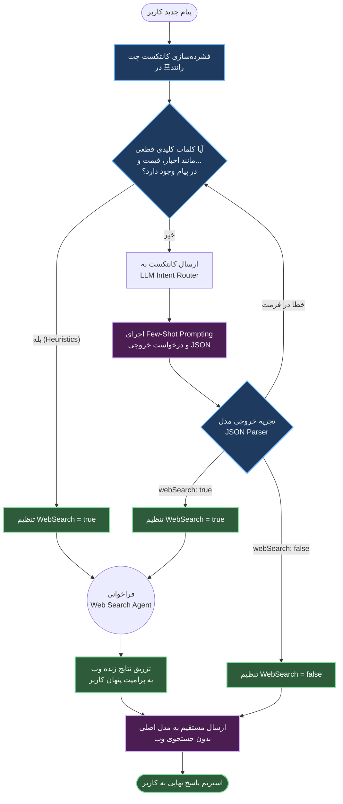
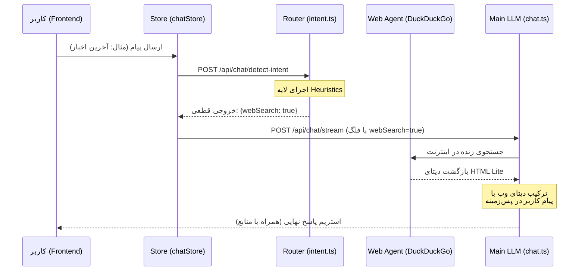

# گزارش فنی: معماری مسیریابی هوشمند مبتنی بر LLM و Heuristics (Hybrid Intent Routing)

این گزارش به بررسی و تحلیل معماری جدید مسیریابی هوشمند (Router) در پروژه Persian AI Chatbox می‌پردازد. هدف از طراحی این سیستم، تشخیص دقیق و بلادرنگِ نیاز کاربر به جستجوی وب (Web Search) یا پردازش‌های خاص (مانند برنامه‌نویسی و تحلیل تصویر) است.

---

## ۱. مقدمه و بیان مسئله
در نسخه‌های پیشین، تشخیص نیاز کاربر به اینترنت تنها بر اساس الگوهای ثابت (Regex) انجام می‌شد. این روش اگرچه سریع بود، اما در درک جملات پیچیده و زبان طبیعی بسیار ضعیف عمل می‌کرد. از سوی دیگر، واگذاریِ کاملِ تصمیم‌گیری به مدل‌های زبانی (LLM) نیز چالش‌هایی داشت؛ از جمله خطای تشخیص در مدل‌های رایگان و یا نادیده گرفتن دستورات در خروجی‌های فرمت‌بندی شده (JSON).
برای حل این مشکلات، معماری **Hybrid (ترکیبی)** پیشنهاد و پیاده‌سازی شد که مزایای هر دو روش را بدون معایب آن‌ها به همراه دارد.

---

## ۲. معماری سیستم (Hybrid Architecture)
سیستم جدید از دو لایه تصمیم‌گیری متوالی تشکیل شده است:

1. **لایه اول: تشخیص قطعی (Deterministic Heuristics Layer)**
   در این لایه، پیام کاربر با مجموعه‌ای از کلمات کلیدی حساس به زمان (مثل *اخبار، قیمت، آب‌وهوا، امروز*) تطابق داده می‌شود. اگر تطابقی یافت شود، سیستم بلافاصله و با اطمینان ۱۰۰٪ جستجوی وب را فعال می‌کند.
   
2. **لایه دوم: تحلیل معنایی (Semantic LLM Layer)**
   اگر لایه اول چیزی پیدا نکند، پیام کاربر همراه با تاریخچه کوتاه شده (Optimized Context) به یک مدل زبانی سریع فرستاده می‌شود. این مدل با استفاده از تکنیک **Few-Shot Prompting** (ارائه مثال‌های از پیش تعیین شده)، خروجی خود را به شکل یک ساختار `JSON` خالص برمی‌گرداند.

> [!TIP]
> **مزیت اصلی:** این معماری باعث می‌شود درخواست‌های روزمره و واضح، بدون تاخیرِ هوش مصنوعی و با دقت ۱۰۰٪ پردازش شوند و جملات پیچیده‌تر، توسط قدرت استدلال LLM رمزگشایی شوند.

---

## ۳. دیاگرام جریان داده (Data Flow Diagram)

در نمودار زیر، مسیر حرکت پیام کاربر از رابط کاربری تا تصمیم‌گیری نهایی برای اتصال به اینترنت نمایش داده شده است:

---

## ۴. چرخه حیات (Sequence Diagram) ارتباطات سرور
نحوه تعامل فرانت‌اند (`chatStore.ts`) با بک‌اند (`intent.ts` و `chat.ts`) در فرآیند مسیریابی:

## ۵. چالش «توهم کنترل» در تعامل با مدل‌های زبانی (Illusion of Control)

یکی از مهم‌ترین دستاوردهای این معماری، غلبه بر پدیده‌ای است که در مهندسی پرامپت به آن **توهم کنترل (Illusion of Control)** می‌گویند. 
توسعه‌دهندگان معمولاً سیستم‌های خود را با مدل‌های قدرتمند (Premium) مانند GPT-4o یا Claude 3.5 تست می‌کنند. این مدل‌ها به دلیل قدرت استدلال بالا، دستوراتی نظیر "خروجی فقط باید JSON باشد" را دقیقاً رعایت می‌کنند؛ در نتیجه برنامه‌نویس دچار توهم کنترل شده و تصور می‌کند سیستم او پایدار است.

اما به محض استقرار برنامه در محیط عملیاتی (Production) و استفاده کاربران از مدل‌های رایگان و سبک‌تر (Tier-Free / Open-Source Models)، مدل‌ها ممکن است از دستورات تخطی کرده و متن‌های اضافی یا فرمت‌های نامعتبر چاپ کنند. 

### راه‌حل: برنامه‌نویسی تدافعی (Defensive Programming)
در معماری پروژه ما، برای مقابله با این توهم، سیستم بر پایه **عدم اعتماد به مدل** بنا شده است. لایه Heuristics و بلوک‌های `try/catch` در پارسر JSON به گونه‌ای طراحی شده‌اند که حتی اگر خنگ‌ترین و ارزان‌ترین مدلِ ممکن نیز فرمت را نابود کند، برنامه متلاشی (Crash) نشود و به جای آن، از طریق مکانیزم قطعیِ مبتنی بر کلمات کلیدی، تصمیم درست را برای کاربر اتخاذ کند.

---

## ۶. جزئیات پیاده‌سازی فنی

- **گارد محافظ (Fallback Guard):** در سیستم پارسر JSON (`parseLLMJsonResponse`)، اگر به هر دلیلی مدل نتواند فرمت JSON استانداردی تولید کند (مانند خطای مدل‌های رایگان)، سیستم دچار Crash نمی‌شود؛ بلکه مکانیزم `try/catch` خطا را کنترل کرده و تصمیم‌گیری را مجدداً به لایه Heuristics واگذار می‌کند.
- **بهینه‌سازی توکن (Token Optimization):** قبل از ارسال تاریخچه چت به LLM Router، پیام‌های قدیمی توسط `buildOptimizedContext` هرس (Prune) می‌شوند. این کار باعث کاهش چشمگیر هزینه‌های API و افزایش سرعت تصمیم‌گیری در مسیریاب می‌شود.
- **تزریق پنهان (Stealth Injection):** دیتای استخراج شده از وب، مستقیماً به پرامپت سیستمی تزریق نمی‌شود (تا مدل‌های متفرقه آن را نادیده نگیرند)؛ بلکه به عنوان یک فایل متنی در انتهای آخرین پیام کاربر گنجانده می‌شود.

> [!IMPORTANT]
> این معماری به دلیل جداسازی منطق مسیریابی از تولید محتوا، به طور کامل با الگوی **Micro-Agents** سازگار است و امکان اضافه کردن عامل‌های جدید (مانند Image Generation Router) را در آینده به راحتی فراهم می‌کند.
